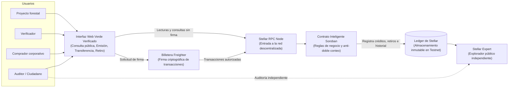

# Product Blueprint

**Nombre del proyecto:** Verde Verificado

**Repositorio :** [verde-verificado](https://github.com/emprendamosahora2030-sudo/verde-verificado)

---

## Contenido

1. Priorización de historias
2. Propuesta de valor
3. Flujo de usuario
4. Alcance del MVP
5. Lean Canvas
6. Backlog priorizado (Kanban)
7. Arquitectura inicial
8. Uso de Stellar y justificación

---

## 1. Priorización de historias

**Criterio de priorización:** (1) resuelve el problema central de doble conteo y doble venta identificado en el Problem Brief; (2) proporciona certeza técnica y confianza verificable e independiente a quienes no controlan el registro; (3) es técnicamente construible y validable en el MVP con el contrato Soroban ya implementado y testeado. Lo que no cumple de forma estricta estos criterios pasa al backlog general como deseable.

| Prioridad | Historia | Propuesta por | Por qué entra al backlog |
| :---: | --- | :---: | --- |
| 1 | Como gestor de Verde Verificado, quiero que el sistema impida automáticamente el doble conteo de un mismo crédito, para proteger la credibilidad del mercado de carbono. | José Luis | Es el núcleo del Problem Brief; sin esta garantía técnica matemática nada más tiene valor. |
| 2 | Como auditor de la autoridad ambiental, quiero ver en una línea de tiempo el historial completo de un crédito (emisión, transferencias y retiro), para comprobar que nunca se vendió ni se usó dos veces. | Daniel | Hace visible y auditable la trazabilidad a terceros de forma independiente, resolviendo fallas como las del caso Pachamama Cumbal. |
| 3 | Como comprador corporativo que compensa emisiones, quiero verificar en tiempo real el estado de un crédito antes de comprarlo, sin necesidad de instalar billetera, para asegurarme de que no ha sido vendido ni retirado. | José Luis / Daniel | Es el punto de interacción donde se previene el fraude y la doble venta en la práctica comercial. |
| 4 | Como gestor de un proyecto forestal comunitario, quiero que un verificador autorizado registre mis créditos verificados, para emitir activos trazables sin intermediarios centralizados. | José Luis | Conecta directamente con el usuario principal del Problem Brief (pequeño generador forestal). |
| 5 | Como verificador ambiental acreditado, quiero emitir un crédito registrando su identificador único y el hash SHA-256 del certificado técnico en el contrato, para garantizar que cada tonelada certificada tenga respaldo inalterable. | Emir | La emisión con huella digital criptográfica es la puerta de entrada; vincula el soporte legal con el activo on-chain. |
| 6 | Como administrador de Verde Verificado, quiero autorizar y revocar verificadores mediante firma administrativa en el contrato, para que únicamente auditores acreditados puedan originar créditos. | Emir | Establece el control de acceso y gobernanza del protocolo, evitando que actores no calificados emitan créditos. |
| 7 | Como auditor de la empresa compradora, quiero cargar el PDF del certificado en la plataforma y validar su huella digital registrada, para detectar certificados adulterados o falsos antes de usarlos. | Daniel / José Luis | Une la evidencia documental off-chain con la verificación descentralizada on-chain. |
| 8 | Como responsable de QA y operaciones, quiero recibir mensajes descriptivos de error y confirmación ante transacciones rechazadas (por ID duplicado o falta de autorización), para diagnosticar fallas de inmediato y garantizar la confiabilidad operativa en campo. | Lina | Asegura la robustez en la experiencia de usuario y el manejo de contingencias operativas ante fallos de validación o red. |

---

## 2. Propuesta de valor

**Usuario (del Problem Brief):** El pequeño proyecto de conservación o reforestación —una asociación campesina, una comunidad indígena o un pequeño propietario forestal (ej. vinculado a programas como RIA / Antioquia Reverdece)— que genera créditos de carbono certificados y busca comercializarlos a un precio justo sin depender de intermediarios que concentren la información.

**Resultado que obtiene:** Cada crédito verificado queda registrado como un activo digital no fungible y único en la red Stellar, con su ciclo de vida completo (emisión, transferencias, retiro) auditable públicamente. El proyecto puede entregar a cualquier comprador corporativo o auditor un código o enlace para que comprueben de forma directa y en segundos que el crédito es auténtico, vigente y no ha sido transado previamente.

**Por qué elegiría esta solución:** Porque elimina la asimetría de información y la dependencia de intermediarios centralizados que concentran los registros y capturan gran parte del margen económico. Al basar la confianza en un registro descentralizado e inalterable, el pequeño productor negocia en igualdad de condiciones, mientras que el comprador reduce a cero su riesgo de fraude o sanción regulatoria (Decreto 973 de 2026), justificando un pago premium por tonelada certificada.

**En qué se diferencia de cómo lo resuelve hoy:** Hoy los créditos coexisten en registros fragmentados y opacos (estándares privados, plataformas de brokers y RENARE) que no sincronizan en tiempo real. En el caso judicializado *Pachamama Cumbal*, un proyecto suspendido por un juez siguió transando cerca de 400.000 créditos porque el registro centralizado no reflejó la medida. En Verde Verificado, el estado, la gobernanza y la trazabilidad son ejecutados por contratos inteligentes públicos sobre Stellar, auditables sin intermediarios ni permisos especiales.

---

## 3. Flujo de usuario

El recorrido de Verde Verificado abarca desde la originación en el proyecto forestal hasta el retiro definitivo e irreversible de la compensación de carbono. Participan cuatro roles principales: el proyecto forestal generador, el verificador técnico acreditado, el comprador corporativo y los auditores o veedores ciudadanos.

| Paso | Rol | Qué hace | Punto de interacción |
| :---: | :---: | --- | --- |
| 1 | Proyecto forestal | Solicita la certificación de sus hectáreas reforestadas y aporta las evidencias y mediciones técnicas de campo. | Proceso de auditoría presencial y técnica en campo |
| 2 | Verificador acreditado | Revisa los datos de campo, emite el dictamen técnico y la plataforma asocia automáticamente una huella digital única al documento. | Portal Verde Verificado *(Módulo de Verificación)* |
| 3 | Verificador acreditado | Origina y emite formalmente los créditos certificados a nombre del proyecto forestal mediante autorización digital segura. | Portal Verde Verificado *(Panel de Emisión)* |
| 4 | Comprador corporativo | Consulta el código del crédito para verificar en tiempo real su autenticidad, vigencia, toneladas y origen antes de negociar. | Buscador público abierto *(Sin registro ni costo)* |
| 5 | Proyecto forestal | Transfiere la titularidad del crédito al comprador mediante firma electrónica; el sistema registra el traspaso en su historial público. | Portal Verde Verificado *(Panel de Gestión de Activos)* |
| 6 | Comprador corporativo | Redime el crédito a nombre de su empresa para compensar emisiones, cancelándolo de forma definitiva e irreversible para evitar doble uso. | Portal Verde Verificado *(Módulo de Compensación)* |
| 7 | Comprador corporativo | Descarga el certificado oficial de compensación con respaldo inalterable y código de validación pública para sus reportes de sostenibilidad. | Portal Verde Verificado *(Descarga de Certificados)* |
| 8 | Auditor / Ciudadano | Comprueba la cadena de custodia completa del crédito y valida que el certificado en PDF no haya sido alterado. | Portal de Transparencia y Auditoría Pública |

**Acceso universal y seguridad por diseño:** Las consultas de información (pasos 4 y 8) son completamente abiertas y públicas: cualquier ciudadano, auditor o ente de control puede verificar la autenticidad y el historial de un crédito en segundos, sin intermediarios, sin crear cuentas y sin barreras de entrada. Por su parte, las operaciones de emisión, transferencia y redención (pasos 3, 5 y 6) cuentan con altos estándares de seguridad y firma digital, garantizando que únicamente los auditores acreditados originen créditos y que solo los dueños legítimos puedan transferir o compensar sus activos.

---

## 4. Alcance del MVP

| Dentro del MVP (Funcionalidad central) | Fuera del MVP (Deseable / Fases posteriores) |
| --- | --- |
| Contrato inteligente Soroban con ciclo de vida completo: emisión individual y por lote atómico, transferencia de propiedad y retiro irreversible. | Interfaz web avanzada con perfiles multi-rol complejos y tableros estadísticos dinámicos. |
| Prevención estricta de doble conteo a nivel de protocolo (identificadores únicos, estado de retiro inmutable, lotes atómicos todo-o-nada). | Integración automatizada y sincronización bidireccional vía API con RENARE y plataformas de estándares internacionales (Verra, Gold Standard). |
| Historial cronológico inmutable y paginado (`historial_credito`) por crédito. | Monitoreo satelital y telemetría IoT automatizada en predios forestales. |
| Verificación criptográfica del PDF del certificado mediante cálculo de huella SHA-256 en cliente. | Dashboard analítico agregado del mercado de carbono y reportes avanzados en PDF/CSV. |
| Consulta pública universal de estado e historial on-chain sin necesidad de autenticación ni billetera. | Módulo de suspensión preventiva de créditos por gobernanza judicial *(previsto para extensión de contrato)*. |
| Despliegue, configuración y ciclo de pruebas exhaustivo ejecutado en Stellar Testnet. | Sistema de reputación on-chain para múltiples entidades certificadoras y despliegue en Mainnet. |

**Por qué el recorte sigue entregando valor:** El valor nuclear y diferencial de Verde Verificado radica en la certeza matemática de que un crédito de carbono no puede duplicarse, revenderse ni modificarse arbitrariamente; dicha garantía reside en la lógica inmutable del contrato Soroban, no en la sofisticación de la interfaz. Un MVP funcional desplegado y probado en Stellar Testnet con una interfaz pública de consulta valida de inmediato la tesis del Problem Brief y satisface los requerimientos del Decreto 973 de 2026. Se reconoce conscientemente el riesgo operativo de operar en paralelo a registros tradicionales: en esta fase MVP, el verificador tiene el deber procedimental de constatar el retiro del crédito en su registro de origen antes de emitir el token en Verde Verificado, asegurando que la solución no actúe como un registro duplicado.

---

## 5. Lean Canvas

**Enlace al Lean Canvas:** [Lean Canvas de Verde Verificado](img/lean-canvas.png)

| Bloque | Detalle estratégico |
|---|---|
| **Problema** | Doble conteo y doble venta de créditos de carbono; falta de trazabilidad pública verificable en tiempo real; vulnerabilidad ante fraudes por registros centralizados y asimetría de información en comunidades forestales. |
| **Segmento de clientes** | **Principal:** Pequeños proyectos forestales y comunidades reforestadoras (RIA / Antioquia Reverdece). **Secundarios:** Compradores corporativos que compensan huella de carbono bajo el Decreto 973 de 2026, y entidades de control/auditoría ambiental. |
| **Propuesta de valor única** | Trazabilidad inmutable, no repudiable y verificable públicamente por diseño sobre Stellar, eliminando intermediarios y garantizando la unicidad de cada tonelada de CO₂. |
| **Solución** | Tokenización de créditos como activos únicos mediante contratos inteligentes Soroban con reglas estrictas anti-duplicación, retiros irreversibles y verificación de huella de certificados. |
| **Canales** | Alianzas institucionales (Programa RIA, Antioquia Reverdece, Corporaciones Autónomas Regionales), ecosistema de innovación (Ruta N), y eventos Web3 (Stellar Apex). |
| **Métricas clave** | Toneladas de CO₂ tokenizadas, créditos retirados exitosamente, transacciones auditadas en el explorador, intentos de doble emisión prevenidos por el contrato. |
| **Ventaja especial** | Seguridad descentralizada y auditoría pública abierta en tiempo real vs. bases de datos privadas dependientes de reportes manuales periódicos. |
| **Estructura de costos** | **Costos de desarrollo e infraestructura:** Mantenimiento de interfaz web, nodos RPC de consulta y auditorías de contratos inteligentes. **Costos de red:** State rent y comisiones de transacción (mínimas en Stellar). |
| **Flujo de ingresos** | Modelo SaaS y micro-tarifas por originación/emisión para grandes emisores; servicios corporativos de reportes automatizados de cumplimiento regulatorio y verificación de cartera. |

---

## 6. Backlog priorizado (Kanban)

Tablero público de seguimiento: [Verde Verificado — GitHub Projects](https://github.com/users/emprendamosahora2030-sudo/projects/2)

El desarrollo se gestiona mediante un flujo Kanban dividido en columnas: *Backlog (fuera del MVP)*, *Por hacer (MVP)*, *En progreso*, *En revisión (QA)* y *Hecho*. Cada tarjeta del tablero está construida a partir de las historias de usuario priorizadas del equipo e incorpora criterios de aceptación verificables bajo el estándar "Dado / Cuando / Entonces", garantizando que cada incremento funcional cumpla tanto las especificaciones técnicas del contrato Soroban como las validaciones de interfaz y seguridad.

---

## 7. Arquitectura inicial

**Diagrama de arquitectura:**

**Enlace al diagrama de arquitectura:** [Diagrama de Arquitectura de Verde Verificado](img/arquitectura.png)

| Capa | Componente | Qué hace |
| :---: | --- | --- |
| **Interfaz de Usuario** | Aplicación Web + Billetera Freighter | Permite la interacción visual para consultas públicas y gestiona la firma segura de transacciones sin exponer llaves privadas. |
| **Lógica de Negocio** | Contrato Soroban `verde-verificado` | Aplica de forma autónoma las reglas del ciclo de vida: control de verificadores autorizados, unicidad de IDs, retiros irreversibles y trazabilidad inmutable. |
| **Red Descentralizada** | Stellar RPC + Ledger Stellar + Stellar Expert | Recibe transacciones firmadas, ejecuta el cómputo on-chain, persiste el estado con retención de TTL y expone la auditoría en exploradores abiertos. |

**En qué punto entra la red:** La red Stellar entra en acción de manera decisiva en cada transición de estado del activo. Cuando un verificador emite un crédito o cuando un propietario transfiere o redime un crédito, la interfaz estructura la transacción, Freighter solicita la autorización criptográfica local al usuario y el nodo Stellar RPC remite la instrucción al contrato Soroban para su validación y persistencia en el ledger. Las consultas de lectura no generan costos ni requieren firmas, accediendo directamente a los datos indexados. De este modo, la red blockchain actúa como la única fuente de verdad incontestable, desacoplando la confianza de la interfaz gráfica y permitiendo que cualquier tercero pueda auditar los registros incluso si la plataforma web estuviese inaccesible.

---

## 8. Uso de Stellar y justificación

**Criterio de pertinencia (del Problem Brief):** Ninguna de las partes involucradas (proyectos comunitarios, intermediarios comerciales, compradores corporativos, entidades certificadoras y autoridades ambientales) acepta que una contraparte particular concentre o modifique el registro del que depende la validez legal del crédito de carbono. Una base de datos centralizada convertiría al administrador de la infraestructura en un intermediario de confianza sujeto a fallas o presiones.

| Componente de Stellar | Para qué lo usamos en Verde Verificado | Por qué este componente y no otra alternativa |
| --- | --- | --- |
| **Contratos Soroban (Rust / WASM)** | Ejecución determinista del ciclo de vida del crédito (emisión autorizada, transferencia, retiro irreversible y lotes atómicos). | Las reglas se ejecutan de forma inmutable e idéntica para todos los actores; un backend tradicional exigiría confiar ciegamente en quien administra el servidor. |
| **Ledger de Stellar** | Registro permanente y descentralizado de los créditos, saldos y cadena cronológica de movimientos. | Garantiza inmutabilidad matemática y persistencia con TTL gestionado, eliminando riesgos de alteración retroactiva. |
| **Cuentas y Claves Criptográficas (`G...`)** | Identificación no ambigua de administradores, auditores verificadores y propietarios de créditos. | La autenticación y autorización se fundan en criptografía de clave pública (`require_auth`), sin contraseñas vulnerables en bases de datos. |
| **Billetera Freighter** | Firma de transacciones directamente en el navegador del usuario. | Las llaves privadas permanecen bajo custodia exclusiva del usuario, cumpliendo los estándares de seguridad Web3. |
| **Stellar RPC** | Enlace de comunicación entre la aplicación web y los contratos Soroban. | Proporciona una interfaz estandarizada y de baja latencia para simular transacciones y enviar operaciones al ledger. |
| **Eventos del Contrato** | Emisión de señales on-chain ante emisiones, transferencias y retiros. | Facilita la indexación y seguimiento en tiempo real por parte de exploradores y aplicaciones sin saturar lecturas puntuales. |
| **Stellar Testnet + CLI** | Entorno de despliegue, simulación y validación continua del protocolo. | Permite verificar exhaustivamente el comportamiento del sistema con costos reales de cero antes de la puesta en producción. |
| **Stellar Expert** | Explorador público y neutral de bloques y transacciones. | Permite que auditores y ciudadanos corroboren la validez de los movimientos sin depender de nuestra propia interfaz. |

Elegimos la infraestructura de Stellar porque combina costos de transacción ínfimos (fracciones de centavo, vital para que los pequeños proyectos forestales no diluyan sus ingresos en gas), confirmaciones en pocos segundos y un protocolo de smart contracts (Soroban) optimizado para la eficiencia energética y la sostenibilidad.
